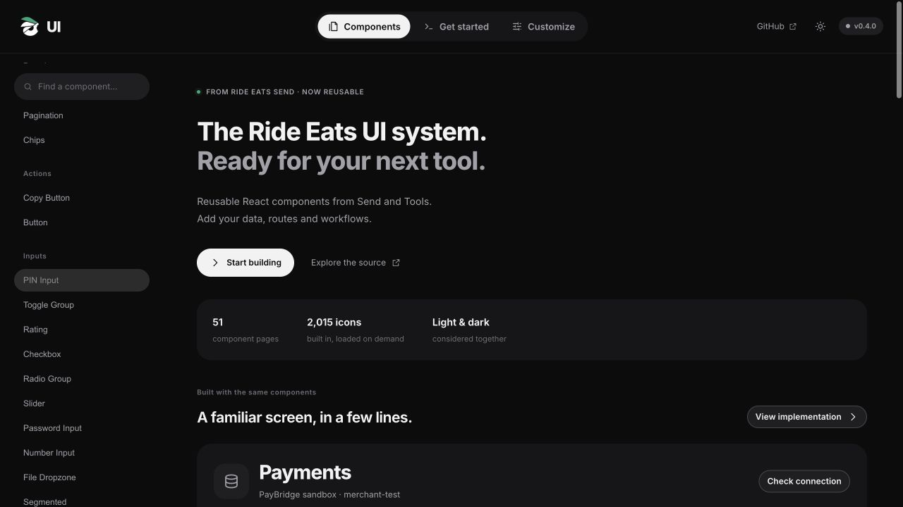

# Ride Eats UI

Version 0.12 improves motion, distinguishes control purposes, and fixes catalog/drag/editor behavior. Version 0.11 added customizable ColorPicker, InputGroup and ButtonGroup primitives. Version 0.10 consolidated duplicate APIs and preserved their behavior in canonical components. See the [0.10 migration guide](docs/migrations-v0.10.md) and [component audit](docs/component-audit.md).

**A complete React UI foundation for Ride Eats tools and internal platforms.**

A React-first UI library extracted from [Ride Eats Send](https://github.com/iamresvevo/ride-eats-send): the animated header and account menu, dropdowns, dialogs, switches, settings rows, date/time picker, skeletons, icons and identity components. Tables, cards, tiles, metrics, inputs, stacked feedback and a bundled Lucide catalog extend the system.

[Live component browser](https://iamresvevo.github.io/ride-eats-ui/) · [Start a working app](docs/implementation.md) · [Component reference](docs/components.md) · [Customization](docs/customization.md) · [Send extraction map](docs/source-map.md) · [Full design audit](docs/design-audit.md)



## Install

React **19+** and React DOM **19+** are peer dependencies. Install a reviewed release from GitHub:

```sh
npm install github:iamresvevo/ride-eats-ui#v0.12.17
```

The package is not published to the npm registry. It ships JSX source for Vite or another JSX-capable bundler. In Next.js, use a client component and add `transpilePackages: ['@ride-eats/ui']` to your Next configuration. TypeScript declarations are included.

## Quick updates

For a short update command, install from `main` once in your React project:

```sh
npm install iamresvevo/ride-eats-ui#main
```

Then get new library changes with:

```sh
npm update @ride-eats/ui
```

Rebuild and deploy your site afterward:

```sh
npm run build
```

Commit `package.json` and `package-lock.json`. Keep `import "@ride-eats/ui/styles.css"` in your app once. No changes to component imports are needed.

This follows the latest `main` commit. For a fixed release, use `npm install iamresvevo/ride-eats-ui#v0.12.17` instead and change the tag when upgrading. `npm update` keeps a fixed tag pinned. The package is not on the npm registry, so `npm install @ride-eats/ui@latest` is not available yet.

With npm 12, GitHub dependencies also require `allow-git=root` in your project's `.npmrc`. See npm's [Git dependency configuration](https://docs.npmjs.com/cli/v12/commands/npm-install/#allow-git) and [update command](https://docs.npmjs.com/cli/commands/npm-update/).

## Start with one component

```jsx
import { Button } from "@ride-eats/ui";
import "@ride-eats/ui/styles.css";

export default function App() {
  return (
    <Button variant="primary" icon="plus" onClick={() => console.log("Create")}>
      Create transfer
    </Button>
  );
}
```

No DOM mounting helpers or manual cleanup. Use React props and state.

For theme, toasts and Send’s tooltips in one place:

```jsx
import { UIProvider } from "@ride-eats/ui";

<UIProvider defaultTheme="system" accent="#1fa476">
  <App />
</UIProvider>;
```

## Responsive layouts

Use `Grid layout="sidebar" sidebarWidth={280}`, `Grid layout="aside" sidebarWidth={360}`, or `Grid layout="split" ratio={[2,3]}` to preserve compact fixed-side or proportional screen layouts. Compose vertical content with `Flex direction="column" gap={12}`, wrapping rows with `Flex`, or varying-height card collections with `Masonry min={240} columns={3}`. Selectable lists can use `Tile variant="row"`; existing-image uploads can use `FileDropzone variant="compact" preview={url}`. See the [layout preview](https://iamresvevo.github.io/ride-eats-ui/#layout).

## Header

```jsx
import { useState } from "react";
import { Header, MenuItem, MenuSub } from "@ride-eats/ui";

export default function AppHeader({ account, signOut }) {
  const [view, setView] = useState("files");

  return (
    <Header
      brand={{
        name: "Studio",
        href: "/",
        logoLight: "/brand-dark.svg",
        logoDark: "/brand-light.svg",
      }}
      items={[
        { value: "files", label: "Files", icon: "files", href: "/files" },
        {
          value: "activity",
          label: "Activity",
          icon: "chart",
          href: "/activity",
        },
      ]}
      activeValue={view}
      onNavigate={(item) => setView(item.value)}
      account={account}
      onSignOut={signOut}
      menuContent={
        <MenuItem icon="settings" onSelect={() => setView("settings")}>
          Settings
        </MenuItem>
      }
    />
  );
}
```

`account` is `{ name, email?, avatar?, verified? }`. Use `loading` while checking a session and `signingOut` while signing out. Provide `guestContent` for a signed-out action. `extras` accepts notifications or other React controls. Omit `onNavigate` to use ordinary links; when supplied, route navigation belongs in that callback. No authentication service or backend is bundled.

Tabs now share Send’s fluid sliding and stretching selection pill. `Segmented` exposes the original Send radio-control API. Both honor reduced motion.

## Dropdowns and tabs

```jsx
import { useState } from "react";
import { Dropdown, Tabs } from "@ride-eats/ui";

export default function FileControls() {
  const [tab, setTab] = useState("all");
  const [sort, setSort] = useState("Newest");

  return (
    <>
      <Tabs
        value={tab}
        onValueChange={setTab}
        items={[
          { value: "all", label: "All files", count: 24 },
          { value: "shared", label: "Shared", count: 8 },
        ]}
      />
      <Dropdown
        trigger="Actions"
        items={[
          { label: "Edit", icon: "edit", onSelect: () => console.log("Edit") },
          {
            id: "sort",
            label: "Sort",
            value: sort,
            items: ["Newest", "Oldest"].map((label) => ({
              label,
              checked: sort === label,
              onSelect: () => setSort(label),
            })),
          },
          { type: "separator" },
          {
            label: "Delete",
            danger: true,
            onSelect: () => console.log("Delete"),
          },
        ]}
      />
    </>
  );
}
```

For full composition, use Send’s original `<Menu trigger={props => <Button {...props}>…</Button>}>` API with `<MenuItem />`, `<MenuSub />`, `<MenuLabel />` and `<MenuSeparator />`.

## Theme and toasts

```jsx
import {
  ThemeProvider,
  ToastProvider,
  Button,
  useTheme,
  useToast,
} from "@ride-eats/ui";

function Controls() {
  const { theme, setTheme } = useTheme();
  const toast = useToast();
  return (
    <>
      <Button onClick={() => setTheme(theme === "dark" ? "light" : "dark")}>
        Appearance
      </Button>
      <Button onClick={() => toast("Changes saved", { tone: "good" })}>
        Save
      </Button>
    </>
  );
}

export default function App() {
  return (
    <ThemeProvider defaultTheme="system">
      <ToastProvider>
        <Controls />
      </ToastProvider>
    </ThemeProvider>
  );
}
```

Override CSS variables after importing the stylesheet:

```css
:root {
  --brand: #1fa476;
  --brand-hover: #1b9169;
  --brand-strong: #1b9169;
  --r-sm: 12px;
  --r-lg: 24px;
}
```

## Component collection

| Area               | Components                                                                                   |
| ------------------ | -------------------------------------------------------------------------------------------- |
| Navigation         | `Header`, `AccountMenu`, `Menu`, `Dropdown`, `Tabs`, `Segmented`, `ToggleGroup`, `Pagination`      |
| Actions            | `Button`, `Icon`                                                                             |
| Inputs             | `Field`, `Select`, `SearchSelect`, `Switch`, `DateTimePicker`                                |
| Feedback           | `Dialog`, `Skeleton`, `Bone`, `BoneText`, `EmptyState`, `ToastProvider`, `useToast` |
| Display and layout | `Card`, `StatCard`, `Badge`, `SettingRow`, `Avatar`, `VerifiedName`, `VerificationBadge`         |
| Theme              | `ThemeProvider`, `useTheme`                                                                  |

See [props and examples](docs/components.md). Preview every component on the [documentation site](https://iamresvevo.github.io/ride-eats-ui/).

## Run the component browser

```sh
git clone https://github.com/iamresvevo/ride-eats-ui.git
cd ride-eats-ui
npm ci
npm run dev
```

Open the Vite URL with `/ride-eats-ui/`. `npm run build` produces the static documentation site in `dist/`. GitHub Actions deploys it to GitHub Pages. `npm run check` checks the vanilla modules; the production build validates the React source and component browser.

## For AI developers

Read [AGENTS.md](AGENTS.md), [the component reference](docs/components.md), and [the extraction map](docs/source-map.md). Prefer `<Header {...props} />` and the other React exports over rebuilding controls. Use `value` / `onValueChange` for library selection controls; Send’s unchanged `Switch` and `DateTimePicker` retain `onChange`. Keep endpoints, auth, translations, business state and routes in the consuming app.

The stylesheet includes global base, form, typography and theme rules. Review it when integrating into an existing design system. Inter loads from Google Fonts with system fallbacks. This is a web React library, not a React Native library. Existing Send and Tools deployments do not automatically consume it.

The older vanilla DOM helpers remain available from `@ride-eats/ui/vanilla`; they are a compatibility entry point. New integrations should use React.

## Build a complete platform screen

[Implementation guide](docs/implementation.md) · [Expanded component APIs](docs/platform-components.md) · [Runnable starter app](examples/starter)

```jsx
<UIProvider>
  <Header brand={brand} items={navigation} account={account} />
  <main className="site-page stack">
    <PageHeader title="Payments" actions={<Button>Check connection</Button>} />
    <Grid preset="metrics">
      <StatCard label="Payments" value="153" hint="1 open" />
      <StatCard label="Paid" value="5" tone="good" />
      <StatCard label="Passed" value="44 / 48" progress={92} />
    </Grid>
    <Card title="Recent payments" description="Shared across your team.">
      <DataTable columns={columns} rows={payments} />
    </Card>
  </main>
</UIProvider>
```

The expanded collection includes **DataTable, Accordion, Alert, Checkbox, RadioGroup, Slider, Progress, PasswordInput, NumberInput, Breadcrumbs, AvatarGroup, CopyButton, FileDropzone, Timeline, Drawer, CardHeader, CardBody, CardFooter, Grid, StatCard, Tile, PageHeader, Toolbar**, and async **useConfirm** / **useFeedback**.

## Built-in icons

**2,015 canonical Lucide glyphs and 277 compatibility names**, plus Send's original glyphs, under one API. The catalog is bundled with the kit in lazy letter groups; it does not use an external icon CDN or add a runtime icon-package dependency. Artwork attribution and the ISC/Feather notices are included in [the icon notice](react/icons/NOTICE.md).

```jsx
<Icon name="headset" size={24} strokeWidth={1.7} />
<Icon motion="auto" size={24} name="loader-circle" playing loop />
<Icon name="check" motion="draw" />
<IconProvider icons={{ brand: <path d="M4 12 12 4l8 8-8 8Z" /> }}>
  <Icon name="brand" size={32} />
</IconProvider>
```

[Search and preview the icon catalog](https://iamresvevo.github.io/ride-eats-ui/#icons). Motion is opt-in and respects reduced motion. Icons are Lucide artwork behind Ride Eats UI's component API, not claimed as original Ride Eats drawings.

## Native SVG motion and more components

[Animated icons](https://iamresvevo.github.io/ride-eats-ui/#animated-icons) lists 87 supported names with explicit SVG choreography, including compatibility aliases. Other catalog icons remain static until their choreography is ready. Playback uses a 2.8-second cycle with a resting pause and honors reduced motion. See [coverage](docs/icon-motion-coverage.json) and [source usage](docs/icon-usage-audit.json).

```jsx
<Icon motion="auto" size={24} name="bell" size={28} />
<Icon motion="auto" size={24} name="heart" playing loop />
<Icon motion="auto" size={24} name="headset" />
<Icon motion="auto" size={24} name="database" playing loop />
<Icon motion="auto" size={24} name="check" playing />
```

The library also includes Popover, CommandMenu, PinInput, ToggleGroup, Rating. Component references, workflows and composition recipes are separated in the browser. Its sidebar search stays pinned, and icon size uses a slider while stroke/motion use segmented selectors.

Keep Dialog mounted and use open={false} for the animated exit. useConfirm resolves after the confirmation has closed, so a parent form can then close without competing animations. Dialog is a simple-sheet demo; Stacked Dialogs demonstrates the draft/discard workflow.

Selected ratings, checkboxes, radio options, toggle groups, steps and sliders use `--brand` / `--brand-soft`. Override those tokens to customize the accent. `--brand-ink` supplies readable accent text in both themes.

### Gestures

```jsx
<Rating value={rating} onValueChange={setRating} />
<ReorderList items={tasks} onReorder={setTasks} />
<RangeSlider value={range} onValueChange={setRange} label="Budget" />
<SplitPane value={split} onValueChange={setSplit}
  first={<Navigation />} second={<Workspace />} />
<Carousel items={cards} renderItem={card => <Card>{card.title}</Card>} />
<SwipeActions actions={[{value:'archive', label:'Archive', onSelect:archive}]}>
  <FileRow />
</SwipeActions>
```

Rating supports drag selection, hover previews and native radio keyboard controls. ReorderList uses stable item IDs and caller-owned ordering, with drag handles, arrow keys and explicit move buttons. SwipeActions reveals actions without executing them; buttons provide the same behavior. Carousel uses native touch scrolling and mouse drag, arrows and dot navigation. SplitPane supports pointer resizing and keyboard arrows/Home/End. RangeSlider uses two native range inputs that cannot cross.

Use gestures where they make the task easier. Static content remains stable. Reduced-motion preferences remove positional animations and smooth scrolling. ReorderList is for bounded lists, not virtualized or cross-column drag-and-drop. SwipeActions shows up to three compact actions; use a menu for longer lists. Touch paths use Pointer Events/native scrolling; physical-device gesture feel still needs validation in each consuming application.

### Compact platform system

[Platform implementation guide](docs/platform-system.md) · [Complete starter](examples/platform/README.md) · [Visual regression checks](tests/visual/README.md)

The browser separates reusable primitives from workflows and recipes. New components cover forms (Form, Textarea, Combobox single/multiple modes, DateRangePicker, TimePicker, UploadProgress), advanced DataGrid tables, AppShell, WorkspaceSwitcher, NotificationCenter, BottomSheet, ContextMenu and reusable SettingsPanel, TeamDirectory, FileManager, Timeline and SupportInbox workflows.

Defaults are compact: 36px controls, 40px DataGrid rows and 16px panel padding. Use `data-density="comfortable"` for larger controls/panels, and `rowHeight={52}` for roomier DataGrid rows. Selected pages include a compact implementation workbench with prop controls and complete copyable React examples. Examples use local state; application endpoints, authentication and persistence belong in caller callbacks.

DataGrid includes local search/filter/sort, column visibility/resizing, pinned columns, bulk selection, expandable rows and optional fixed-row virtualization. Use DataTable for fully caller-controlled server table state. Native overlays support nested popovers, keyboard dismissal and focus restoration. See the implementation guide for browser support and integration limits.

The icon browser plays the selected glyph once immediately, with Replay and optional Loop preview controls. Copied JSX includes `playing` (and `loop` when selected) to match the preview. Catalog thumbnails remain hover-driven. Sidebar labels use 14px text with stronger neutral contrast while rows stay compact.

## v0.8 API and interaction audit

Use the [component audit](docs/component-audit.md) to choose the right primitive and the [migration guide](docs/migrations-v0.8.md) when upgrading. Four duplicate public APIs were removed. CommandMenu now provides grouped, nested command search with recent actions, keyboard shortcuts and async error recovery; its demo performs local workspace actions. WorkspaceSwitcher uses the shared Send menu.

Native popovers and contextual menus animate both opening and closing. Context submenus unfold with the same motion as Dropdown. SwipeActions uses compact pill buttons and preserves item identity while revealing actions. Selected icon previews play immediately, with Replay and opt-in Loop. Reduced motion disables nonessential movement. Static content stays steady.

### Send/Tools motion and floating controls

Use `<StickyBar><Tabs ... /></StickyBar>` for automatic page floaters below Header. It detects the scroll container and progressively fades the content underneath without blur. Set `offset={0}` in independent scroll regions. The component browser now uses the shared Segmented, Select, Accordion, Card, Field, NumberInput, Switch and CopyButton implementations rather than parallel documentation controls. See [implementation](docs/implementation.md) for solid action tones, circular controls, complete React examples and motion configuration.

## Keeping the system consistent

`css/tokens.css` owns the Send/Tools foundation. Component styles consume its solid palette, pill/circle/panel corners, compact density and shared motion. `npm run design:check` rejects drift and is required in CI. The [full audit](docs/design-audit.md) maps every public API and docs page to its design family and owning references. Single-line controls and toggle selection follow the same pill/ink language as the shared Segmented control. Consumer CSS can override tokens after the library import.

### Persistent modal controls and editor panels

`Dialog` now defaults to `scroll="body"`: its title/Close, optional `toolbar` slot and footer stay visible while the body scrolls. Use `scroll="dialog"` for legacy whole-surface scrolling. Put primary actions in `footer`, not at the bottom of long body content. Existing native dialog focus, Escape, stacking and close animations are preserved.

`Workbench` arranges three bounded desktop panels with `leadingWidth`, `trailingWidth`, `height` and `gap`; it stacks below 1000px. Use `ScrollArea label="..." header={...} footer={...}` for independently scrolling catalogues and option forms. Its header/footer stay outside the native keyboard-scrollable content. Give standalone ScrollArea a bounded height via its style or parent layout. Keep canvas input in the middle panel; the library owns its flexible available height. Menus and selects continue to use their own popup positioning.

Tile customization: `density="compact"`, `imageSize={32}`, `imageFit="contain" | "cover"`, `titleLines={2}`, `showFooter={false}` and `selected` work with card and row variants. Grid accepts `density="compact"` (8px default gap and inherited compact tiles), `columns={3}` (responsive maximum), `min={120}` and `gap={8}`. Full titles remain in the DOM when visually clamped.

NumberInput supports `buttonStep` independently of native `step`: use `step={0.01} buttonStep={1}` for monetary entry with cent precision and whole-unit −/+ buttons. Buttons preserve existing cents and clamp to min/max.

Flat navigation: `Tabs variant="flat" width="full"` keeps controlled panel/tab semantics with a bottom divider and plain counts. Compose with StickyBar for pinned panel controls. `SectionNav` provides actual anchor links for sectioned pages, automatic active-section tracking and `sticky`/`offset` props; target IDs belong to the consuming page. It scrolls horizontally on narrow screens and respects reduced motion. No pill container is added.

`SplitPane variant="plain"` composes existing Cards without duplicate backgrounds/padding. `collapseAt={800}` stacks the panels and hides the resize handle below the supplied container width. Desktop handles support pointer dragging and arrow/Home/End keys. The Seasons page uses a wider 36% leading panel, adjustable between 30% and 48%.

Toolbar defaults to `align="end"` so labelled fields, hidden-label search inputs and buttons share a control baseline; `start` and `center` remain available. For a table panel, use `<Card padding="none" footer={pagination}><DataTable variant="inset" ... /></Card>` to keep one surface. DataTable column `wrap: true` with `width` allows long identifiers and secondary text to wrap instead of pushing actions off screen. Badges retain intrinsic width inside Flex.

DataTable defaults to `variant="auto"`: standalone outside Cards, inset inside them. Choose `standalone` to explicitly retain the table border. `cellAlign="top"` aligns multi-line row content at its first line; the default is `middle`.

### Four focused additions

[Image Compare](https://iamresvevo.github.io/ride-eats-ui/#image-compare), [Tree View](https://iamresvevo.github.io/ride-eats-ui/#tree-view), [Signature Pad](https://iamresvevo.github.io/ride-eats-ui/#signature-pad) and [Activity Heatmap](https://iamresvevo.github.io/ride-eats-ui/#activity-heatmap) add distinct inspection, hierarchy, pointer drawing and calendar-history interactions. They use controlled caller data and the existing foundation tokens. Each has a live example, type declarations and documented input/accessibility boundaries. Source: `react/specialized.jsx`; no Reacticx implementation or media is copied.

Flat Tabs show the active item with a sliding underline and stronger text. Use `variant="flat"`; the default pill style remains available.

Header supports `fade={true}` (default) and `fadeSize={72}` for the neutral gradient beneath sticky controls. The fade now tracks the nearest native scrolling ancestor as well as document scrolling and the existing page layout. It uses no backdrop blur. Match the header’s containing surface with the shared `--bg` token.

ImageCompare uses pointer capture and a fixed drag-start rectangle for direct, subpixel reveal. It keeps a native range for assistive technology, Arrow keys (1%), Shift+Arrow (10%), and Home/End. The example reserves percentage-output width so changing digits cannot resize the comparison surface.

## Review tools

[Shortcut Recorder](https://iamresvevo.github.io/ride-eats-ui/#shortcut-recorder) captures and reviews a binding with conflict checks. [Text Diff Viewer](https://iamresvevo.github.io/ride-eats-ui/#text-diff-viewer) performs line comparison with folding, split/unified views and synchronized scrolling. See [0.10 migration](docs/migrations-v0.10.md) for behavior and limits.

ColorPicker, InputGroup and ButtonGroup provide customizable colors and composable form/action controls. See [the API and examples](docs/components.md#color-picker).


Header navigation stays within the available space beside the brand and account. Overflowing menus show directional fades and edge controls. Fine-pointer hover scrolls with acceleration and deceleration; click advances the menu, touch/trackpad scrolling remains native, and focused/active links are revealed. Reduced motion disables hover scrolling and animated reveal. Layout direction is currently left-to-right.

## Image galleries

`ImageThumbnail` lazily loads image previews near the viewport. `ImageGallery` composes the shared Dialog with previous/next controls, arrow-key navigation, fit/zoom, loading and retry states, and app-owned action slots. See [the component reference](docs/components.md#image-gallery). Authentication and source caching stay in the consumer.

Select and Combobox accept a `placeholder` string. A legacy prompt in an options array can be marked `{ value: "", label: "Choose an item", placeholder: true }`. Placeholder options are omitted from the menu and keyboard navigation. Empty values without this flag remain selectable for meaningful choices such as All or None.

`Field` accepts `warning` for non-blocking inline feedback with a warning icon and semantic color. Errors take precedence, then warnings, then hints. Warnings describe the input without setting `aria-invalid`.

`ImageGallery` supports `inline` and an optional CSS `height` for embedded photo inspection. Both inline and dialog viewers share zoom-in/out, Fit, double-click zoom and pointer-captured drag panning. Keyboard +/− zoom, 0 fits, and arrow keys scroll zoomed images. `renderActions` adds caller actions such as Expand.

`Workbench layout="comparison"` provides two equal panes with a fixed first pane and independently scrolling content below the second pane header. It stacks on narrow screens. Use `ImageGallery inline fill` to fit its image and controls to the available pane height.

Use `<DataTable stickyFirstColumn stickyLastColumn ... />` to keep the first and last rendered columns visible while the middle scrolls horizontally. Each prop accepts a boolean or a column count and defaults to false. For example, `stickyFirstColumn={2}` pins selection and receipt identity together. Widths are measured automatically and updated on resize. Selection and action columns count as rendered edge columns. Empty/loading rows remain full width. A subtle neutral fade marks hidden scrolling content beside each pinned edge and disappears at that scroll boundary. Left pins take precedence if counts overlap.
